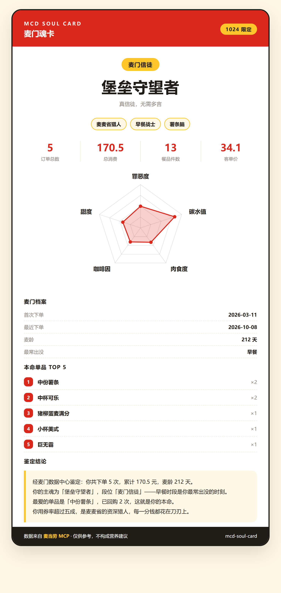

# 🍔 麦门魂卡 · mcd-soul-card

> 你的订单，早就写好了你的麦门人格。

基于 **麦当劳 MCP** 的真实历史订单数据，鉴定你的**主魂、段位与口味雷达**，
生成一张可以晒出去的专属魂卡。

为 [麦当劳程序员创意开发大赛](https://github.com/M-China/mcd-developer-innovation-challenge) 参赛作品。

> ⭐ **本项目正在参加麦当劳程序员创意开发大赛，排名以 GitHub Star 数为依据。**
> 如果它对你有用，欢迎点个 Star —— 每一个都是冲榜的燃料。

🎮 **不想装环境？30 秒在线测一张：** <https://mcd-soul-card.app.workbuddy.host/?sharecode=WC6YBA4BL2>

---

## ✨ 效果



从你的历史订单里算出：

| 维度 | 说明 | 例子 |
|---|---|---|
| 🧬 **主魂** | 按品类偏好判定 | 堡垒守望者 / 薯条原教旨主义者 / 脆皮狂信徒 / 咖啡续命工程师 |
| 🏅 **段位** | 按累计订单数判定 | 麦门路人 → 信徒 → 执事 → 长老 → 圣徒 |
| 🏷️ **行为标签** | 按时段与用券习惯判定 | 麦麦省猎人 / 深夜食堂常客 / 原价贵族 / 单点刺客 |
| 📊 **口味雷达** | 五维可视化 | 罪恶度 · 碳水值 · 肉食度 · 咖啡因 · 甜度 |
| 🍟 **本命单品** | 回购次数 TOP 5 | — |

最终输出一张可直接分享的卡片。

---

## 🚀 快速开始

### 1. 申请 MCP Token

访问 https://open.mcd.cn/mcp ，手机号登录后进入控制台，点击「激活」申请 Token。

### 2. 安装依赖

**无需安装任何依赖** —— 项目仅使用 Python 标准库。

```bash
git clone https://github.com/xiaomijituan/mcd-soul-card.git
cd mcd-soul-card
```

### 3. 配置 Token

```bash
export MCD_MCP_TOKEN='你的Token'
```

Windows PowerShell：

```powershell
$env:MCD_MCP_TOKEN='你的Token'
```

### 4. 生成你的魂卡

```bash
python src/main.py
```

生成的卡片在当前目录：`mcd_soul_card.html`，浏览器打开即可查看 / 截图分享。

---

## 🧮 营养教练

除了人格鉴定，项目还内置了一个基于 **麦当劳 MCP 真实营养数据**（160 个餐品）的套餐推荐器。

```bash
python src/main.py --coach 减脂
python src/main.py --coach 增肌 --city 济南 --keyword 历下
```

**可选目标**：`减脂` / `增肌` / `省钱` / `解馋` / `加班`

输出示例：

```
  麦门营养教练 · 目标「减脂」
  同等热量下蛋白质占比最高，碳水负担最小
  ----------------------------------------------
  推荐搭配：
    · 原味板烧鸡腿炒双蛋堡    419 千卡  蛋白 27.0g  碳水 30.0g  脂肪 21.0g
    · 小薯条                  210 千卡  蛋白  3.0g  碳水 28.0g  脂肪  9.0g
    · 卡布奇诺大杯            223 千卡  蛋白 13.0g  碳水 20.0g  脂肪 10.0g
  ----------------------------------------------
  合计：852 千卡 | 蛋白 43g | 碳水 78g | 脂肪 40g | 钠 955mg
  热量约等于：6.1 罐可乐 / 3.4 份麦辣鸡腿堡 / 3.9 份薯条
```

**推荐逻辑**（全部基于真实营养数值计算，无硬编码餐品表）：

- 先按品类分组（主食 / 小食 / 饮品），**在品类内部**比较，避免出现「把 0 千卡的饮料当主食」这类错误
- 减脂：单位热量蛋白质密度最高、热量适中
- 增肌：蛋白质密度优先，碳水足
- 省钱：优先小份组合（迷你薯条、小杯饮料）
- 解馋 / 加班：热量拉满，蛋白管够

> 加 `--city` 和 `--keyword` 会额外查询附近真实门店（受营业时间限制，失败时自动降级，不影响推荐）。

---

## 📖 使用示例

### 生成卡片并导出数据

```bash
python src/main.py --out my_card.html --json my_data.json
```

### 限制拉取订单数量

```bash
python src/main.py --limit 50
```

### 无 Token 也能看效果（演示模式）

```bash
python src/main.py --demo
```

演示模式使用内置示例订单，**不会调用 MCP**。

### 完整参数

| 参数 | 说明 | 默认值 |
|---|---|---|
| `--demo` | 使用示例订单（营养数据仍取自真实 MCP） | 关闭 |
| `--limit` | 拉取订单数量上限 | 100 |
| `--out` | 卡片输出路径 | `mcd_soul_card.html` |
| `--json` | 同时导出人格数据 JSON | 不导出 |
| `--coach` | 营养教练模式，可选 `减脂`/`增肌`/`省钱`/`解馋`/`加班` | 关闭 |
| `--city` | 城市名（配合 `--coach`） | 空 |
| `--keyword` | 门店关键词（配合 `--coach`） | 空 |

### 终端输出示例

```
==============================================
  麦门魂卡 · 鉴定结果
==============================================
  人格称号：堡垒守望者
  段位徽章：麦门信徒
  行为标签：麦麦省猎人 / 早餐战士 / 薯条脑
----------------------------------------------
  订单总数    : 5
  总消费     : 170.5
  餐品件数    : 13
  客单价     : 34.1
  首次下单    : 2026-03-11
  最近下单    : 2026-10-08
  麦龄      : 212 天
  最常出没    : 早餐
----------------------------------------------
  本命单品：
    · 中份薯条  ×2
    · 中杯可乐  ×2
    · 猪柳蛋麦满分  ×1
    · 小杯美式  ×1
    · 巨无霸  ×1
==============================================
```

---

## 🌐 网页版（无需 Token 即可体验）

`web/index.html` 是一个纯前端单文件页面，答 5 道口味题即可出卡，
可直接保存为图片分享。用浏览器打开即可，**不依赖任何外部资源**。

适合先让人玩起来，再引导到仓库点 Star。

---

## 👥 目标用户

- 想看看「自己的麦当劳消费到底是什么画风」的普通用户
- 想了解麦当劳 MCP 能力、寻找接入范式的开发者
- 想做数据可视化 / 趣味人格类小工具的开发者

---

## 🧠 人格算法

结论全部可回溯到订单真实数字，不做随机数：

- **主魂**：按品类（汉堡 / 薯条 / 炸鸡 / 咖啡 / 甜品 / 早餐 / 饮料）件数占比取最大值
- **段位**：按累计订单数分档（5 / 20 / 50 / 100 单）
- **行为标签**：按时段分布、用券率、品类集中度判定
- **口味雷达**：由品类结构与营养数据加权映射到 0–100

品类归类采用关键词匹配，规则集中在 `src/persona.py` 的 `CATEGORY_RULES`。

---

## 📁 项目结构

```
mcd-soul-card/
├── README.md                 # 本文件
├── CONTEST_DECLARATION.md    # 参赛声明（官方原文，未改动）
├── MCP_INTEGRATION.md        # MCP 接入说明
├── mcp-config.example.json   # 脱敏配置示例（仅占位符）
├── workbuddy.md              # WorkBuddy 开发对话上下文
├── SKILL.md                  # Skill 定义
├── PROMO.md                  # 冲榜推广物料（5 个平台的成品文案）
├── HANDOVER.md               # 参赛推送与报名交接文档
├── src/
│   ├── main.py               # 主入口
│   ├── mcp_client.py         # MCP 客户端（Streamable HTTP，零依赖）
│   ├── persona.py            # 人格鉴定算法
│   ├── nutrition.py          # 营养教练（真实营养数据解析 + 分目标推荐）
│   └── card.py               # 卡片渲染
├── tests/
│   ├── test_normalize.py     # 38 项断言
│   └── test_nutrition.py     # 41 项断言
├── web/
│   └── index.html            # 网页版（单文件，离线可用）
└── images/
    └── demo_card.png         # 示例卡片
```

---

## ✅ 测试

```bash
python tests/test_normalize.py    # 38 项
python tests/test_nutrition.py    # 41 项
```

共 **79 项断言**，覆盖：Markdown 响应提取、真实字段名解析、套餐子项展开、
已取消订单过滤、空数据兜底、品类归类、时段标签平票判定、雷达图数值范围、
营养表解析、跨品类推荐、套餐热量核算、订单×营养表匹配率。

设置 `MCD_MCP_TOKEN` 后会额外执行**真实 MCP 连通性测试**：

```bash
MCD_MCP_TOKEN=xxx python tests/test_normalize.py
```

---

## 🐛 已处理的真实坑

开发时通过真实调用麦当劳 MCP 发现了几个文档里没写的问题，都已修复并固化为测试：

| 坑 | 说明 |
|---|---|
| **响应不是纯 JSON** | 返回是 Markdown 包装，真实数据在 `## Original Response` 之后 |
| **JSON 外面还跟着说明文字** | 部分工具的 JSON 后面直接跟说明，`json.loads` 会失败，改用 `raw_decode` 只取前缀 |
| **`data` 字段本身是字符串化 JSON** | 需要递归深度解析才能拿到真正的数组 |
| **说明文字里的 `data[].xxx` 会被误判** | 扫描 JSON 时只接受 `{` 开头且结果为对象，否则会把 `[]` 当成空数组 |
| **字段名不能猜** | 实际是 `createTime` / `realTotalAmount` / `orderProductList[].productName` |
| **套餐子项要展开** | `orderProductList[].comboItemList` 里的商品同样计入统计 |
| **已取消订单要过滤** | `orderStatus` 含「取消」的订单不该进人格统计 |
| **空 data 会造出假订单** | `{"data":{}}` 会被兜底成一条空订单 |
| **门店查询要 city + keyword 同给** | `searchType=2` 时只给一个会返回 600058 |
| **门店菜单受营业时间限制** | 打烊时 `query-meals` 返回 600057，营养推荐需能独立降级 |
| **营养数据是紧凑表格文本** | 不是 JSON，需按 `[总数]{字段}:` 的格式自行解析 |

---

## 🔧 技术说明

- **零依赖**：仅使用 Python 标准库（`urllib` / `json` / `ssl`），无需 `pip install`
- **协议**：完整实现 MCP Streamable HTTP 握手（`initialize` → `notifications/initialized` → `tools/call`）
- **兼容性**：同时支持服务端返回纯 JSON 与 SSE（`text/event-stream`）两种响应形态
- **字段容错**：兼容 `orderTime` / `createdAt` / `create_time` 等多种字段命名

---

## ⚠️ 免责声明

本项目为麦当劳程序员节创意开发大赛参赛作品，由参赛者独立开发，
**非麦当劳官方产品**。项目输出仅供参考，**不构成医疗、营养或其他专业建议**；
餐品信息、价格及供应状态以麦当劳官方渠道的实时结果为准。
